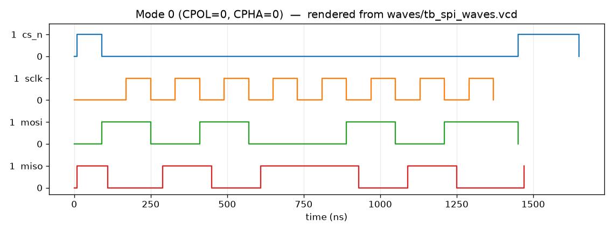
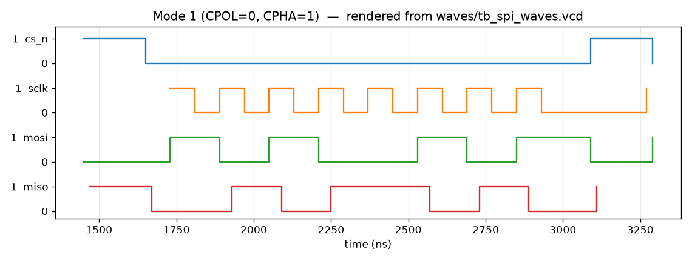
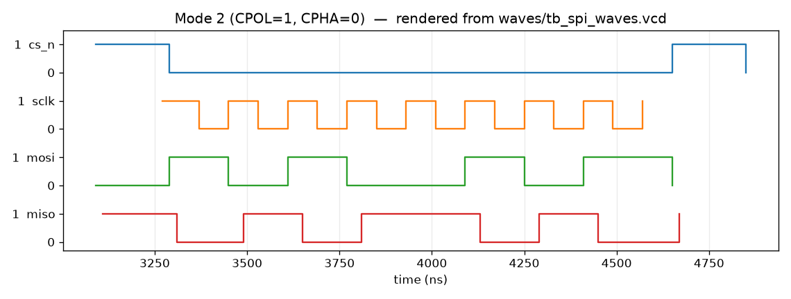
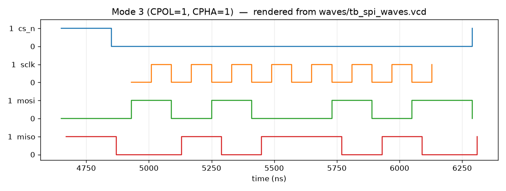

# SPI Master/Slave IP Core

An SPI master and slave in synthesizable Verilog, with an AMBA 3 APB register
interface and self-checking testbenches. The master supports all four SPI
modes (CPOL/CPHA), MSB or LSB first, 8/16/32-bit words (the width is a
parameter, default 32), a programmable clock divider, back-to-back words with
CS held low, and an abort input. The slave samples SCLK and CS into the
system clock domain and flags a mid-word CS rise. All numbers below are
copied from the logs in [`results/`](results).

**Author:** B. Srishanth Reddy

## Features

**Master (`rtl/spi_master.v`)**
- Modes 0 to 3 (CPOL and CPHA)
- `clkdiv` sets the SCLK half-period in system clocks, so f_SCLK = f_clk / (2 * clkdiv). A write of 0 is treated as 1.
- Word length `nbits` from 1 to `MAX_WIDTH` (default 32). Data is right-justified.
- MSB first or LSB first
- `cs_keep` holds CS low between words
- `done` is a one-cycle pulse after each word; `abort_req` raises CS if a word is in progress

**Slave (`rtl/spi_slave.v`)**
- Same mode, bit order and word length as the master
- `ASYNC=1` (default) uses two flip-flops on SCLK, CS and MOSI. `ASYNC=0` is for a master on the same clock.
- Drives MISO only while CS is low
- `rx_valid` is a one-cycle pulse after `nbits` samples. A mid-word CS rise drops the partial word and pulses `mid_cs_abort`.
- If CS is tied low, words are framed by the bit count.

**APB wrapper (`rtl/spi_apb.v`)**
- AMBA 3 APB, zero wait states
- Registers for CTRL, CLKDIV, TXDATA, RXDATA and STATUS (see [docs/register_map.md](docs/register_map.md))
- A TXDATA write starts a transfer when the master is ready; a write while busy sets `cmd_err`
- `irq` on done, command error, abort or overrun

**Loopback and FPGA**
- `rtl/spi_loopback.v` ties the master to a same-clock slave (`ASYNC=0`)
- `fpga/spi_icebreaker.v` plus `fpga/icebreaker.pcf` is a small on-chip loopback for the iCEBreaker

## Architecture

```
  software / testbench
           |
      [ spi_apb ]  optional APB registers
           |
      [ spi_master ] ---- sclk, mosi, cs_n ----> [ spi_slave ]
           ^                                     |
           +-------------- miso -----------------+
```

CS falls one half-period before the first SCLK edge and, unless `cs_keep` is
set, rises one half-period after the last edge. Ideal timing for all four
modes is in [docs/timing.md](docs/timing.md). How to hook the core up is in
[docs/integration.md](docs/integration.md).

## Register map (short)

| Offset | Name   | Access | Reset | Notes |
|--------|--------|--------|-------|--------|
| 0x00   | CTRL   | RW     | 0     | enable, cpol, cpha, lsb_first, irq_en, width, cs_keep, abort |
| 0x04   | CLKDIV | RW     | 8     | SCLK half-period in PCLK cycles |
| 0x08   | TXDATA | RW     | 0     | write starts a transfer if enable and tx_ready |
| 0x0C   | RXDATA | RO     | 0     | last received word; a read clears rx_ready |
| 0x10   | STATUS | RO/W1C | 0     | busy, done, rx_ready, tx_ready, overrun, aborted, cmd_err |

Full bit fields and a software sequence are in [docs/register_map.md](docs/register_map.md).

## How to run

### Linux

Tools used for the logs in this tree: Icarus Verilog 14.0, Verilator 5.055,
Yosys 0.70, nextpnr-ice40 0.11, SymbiYosys 0.70 (see
`results/tool_versions.txt`).

```bash
make core apb          # Icarus directed tests
make edge rand         # Verilator + SVA (SEEDS="1 42 2026" by default)
make lint              # Verilator --lint-only -Wall
make synth             # Yosys + nextpnr-ice40 (iCEBreaker)
make formal            # SymbiYosys BMC and cover
make waves             # VCD + rendered waveform PNGs
make neg               # injected bugs must be caught
make all               # core, apb, edge, rand, lint
```

`bash scripts/run_all.sh` runs the same directed and random tests.

### Windows (OSS CAD Suite at `C:\oss-cad-suite`)

```bat
run_sim.bat
```

or, in PowerShell:

```powershell
powershell -ExecutionPolicy Bypass -File run_sim.ps1
```

That runs the two Icarus testbenches and writes logs under `results\`. For
GTKWave: `gtkwave waves\tb_spi_core.vcd`. The Verilator testbenches, SVA,
coverage and formal flow need Linux or WSL.

## Test results

Copied from `results/`. A test is only marked PASS if the run printed that.

| Testbench | What it checks | Result | Log |
|-----------|----------------|--------|-----|
| `tb_spi_core` | All 4 modes, MSB/LSB, 8/16/32-bit, CS held low, clkdiv 2/3/8/16, walking patterns, odd LSB | **10/10 PASS**, 179 checks, 0 errors | `results/tb_spi_core.log` |
| `tb_spi_apb` | Register access, 8/16/32-bit through APB, irq, cmd_err, bad width, abort, write while disabled | **7/7 PASS**, 36 checks, 0 errors | `results/tb_spi_apb.log` |
| `tb_spi_edge` | Mid-word abort, word lengths 1/4/8/16/32, clkdiv=0 (clamped to 1), clkdiv=65535, CS tied high, CS tied low, reset mid-transfer, overrun | **8/8 PASS**, 20 checks, 0 errors | `results/tb_spi_edge.log` |
| `tb_spi_rand` seed 1 | Constrained-random full-duplex + scoreboard, including CS-held bursts | **111 transfers, 222 checks, 0 errors** | `results/tb_spi_rand_seed1.log` |
| `tb_spi_rand` seed 42 | Same | **120 transfers, 240 checks, 0 errors** | `results/tb_spi_rand_seed42.log` |
| `tb_spi_rand` seed 2026 | Same | **116 transfers, 232 checks, 0 errors** | `results/tb_spi_rand_seed2026.log` |
| Negative tests | `INJECT_BUG_SAMPLE` (wrong sample edge), `INJECT_BUG_DONE` (done stays high) | **Both caught** (data mismatch / SVA A2) | `results/negative_tests.log` |
| Formal BMC | Master, depth 60, `clkdiv=2`, 8-bit, stable CPOL/CPHA | **PASS** | `results/formal_bmc.log` |
| Formal cover | `cover(done)` | **Reached at step 35** | `results/formal_cover.log` |
| Lint | `verilator --lint-only -Wall` on master, slave, APB and loopback | **No warnings** | `results/lint_all.log` |

Directed functional counts from `tb_spi_core` (transfer counts, not a coverage database):

    modes 0/1/2/3 = 22/16/7/9
    msb/lsb = 49/5
    width 8/16/32 = 48/2/4
    cs_keep words = 3, full-duplex = 54

Random test, seed 1 (the other seeds are in the same folder):

    modes 0/1/2/3 = 28/26/25/32
    msb/lsb = 64/47
    width 8/16/32 = 33/32/46
    cs_keep words = 27
    clkdiv 2: 43, clkdiv 3 or 5 or 8: 68

SVA hit counts from the same seed-1 run: A1 idle CS high = 185, A2/A3 done = 111,
A4 accepted start = 104, A7 busy = 18255. A5 (aborted) and A6 (disabled and
idle) are 0 in the random run because that test does not abort or drop enable;
the directed edge test does check abort and disable in another way.

Verilator coverage from the random test (`results/coverage.txt`):

    line 89.8 % (53/59)    toggle 87.5 % (1661/1898)
    branch 83.3 % (120/144)    expr 92.5 % (248/268)

Those percentages are for the points Verilator counted in that run, not for
every line of every file. Annotated sources are in `results/cov_anno/`.

`clkdiv=1` produces SCLK = clk/2, and that half-period was measured, but
same-clock loopback is not supported at `clkdiv=1`. The minimum for master
plus slave on one clock is `clkdiv=2`.

## Waveforms

These plots were rendered from `waves/tb_spi_waves.vcd` with matplotlib.
They are not GTKWave screenshots.









Ideal (not simulated) timing drawings are in [docs/timing.md](docs/timing.md).

## Synthesis

Yosys 0.70+368, `synth -flatten` plus `abc -g cmos2` for the generic column,
`synth_ice40` for the iCE40 column. Place-and-route of the iCEBreaker top was
done with nextpnr-ice40, iCE40UP5K-SG48, `fpga/icebreaker.pcf`, seed 1. Full
tables and logs: `results/synth_summary.txt` and `results/synth/`.

| Top | Generic cells | Generic FF | iCE40 LUT4 | iCE40 FF | iCE40 CARRY |
|-----|---------------|------------|------------|----------|-------------|
| `spi_master` | 1511 | 136 | 394 | 136 | 47 |
| `spi_slave` | 1051 | 125 | 270 | 125 | 15 |
| `spi_apb` | 1628 | 196 | 426 | 197 | 42 |
| `spi_loopback` | 2491 | 258 | 644 | 258 | 59 |
| `spi_icebreaker` | 886 | 105 | 206 | 105 | 22 |

`spi_icebreaker` on the UP5K: 258 / 5280 logic cells (4 %), 8 I/O, **Fmax 54.27 MHz**
(PASS at the 12 MHz board clock). The raw `spi_loopback` top was not placed:
it has 172 ports, which is more I/O than the part has.

## Folder structure

```
rtl/      spi_master.v, spi_slave.v, spi_apb.v, spi_loopback.v
tb/       directed, edge, random and waveform testbenches, plus spi_monitor.v
sva/      spi_sva.sv (used with Verilator)
formal/   SymbiYosys scripts for the master
fpga/     iCEBreaker top and pin file
scripts/  Linux helpers (run_all, synth, vbuild, neg_tests, plot scripts)
docs/     register map, integration, timing, limitations, figures
results/  logs and synthesis/coverage reports from the runs above
```

## Limitations

See [docs/limitations.md](docs/limitations.md) for the full list. The short
version: same-clock loopback needs `clkdiv >= 2`; there is one CS, no FIFO and
no DMA; formal proofs are bounded (depth 60) and only cover the master; the
iCEBreaker design has been placed and timed but not run on a board.

## What I would do next

- Put a shallow TX/RX FIFO in the APB wrapper so software does not have to
  poll every word.
- Add more than one chip-select, with a small slave-select register.
- Run the iCEBreaker build on a real board and check the PMOD pins with a
  logic analyser, and later talk to a real SPI flash or sensor.
- Extend the formal checks to the slave, and try a longer unbounded proof.
- Put this SPI core next to the UART and I2C cores behind one APB bus.

## License

MIT, see [LICENSE](LICENSE). Copyright (c) 2026 B. Srishanth Reddy.
