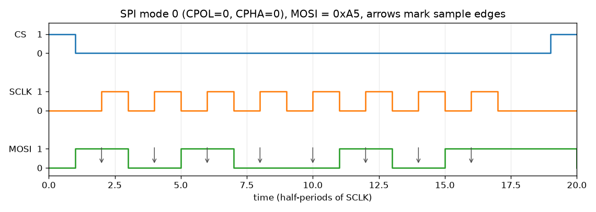
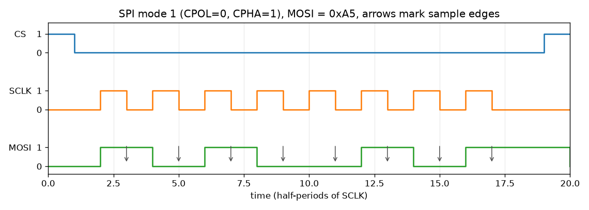
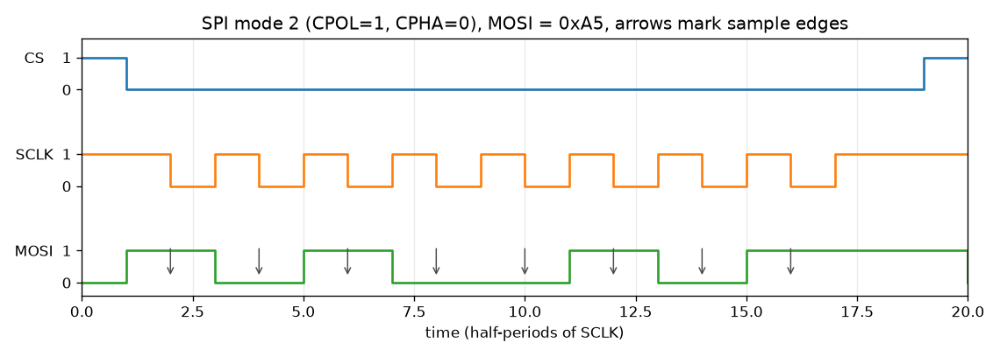
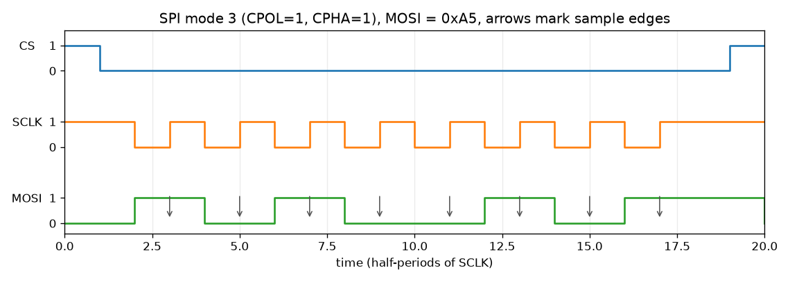

# SPI timing (modes 0 to 3)

The four modes are the usual Motorola mapping of CPOL and CPHA.

- CPOL is the idle level of SCLK (the level while CS is high).
- CPHA=0: the first bit is on MOSI/MISO before the first SCLK edge, and data
  is sampled on the leading edge.
- CPHA=1: data changes on the leading edge and is sampled on the trailing
  edge.

The diagrams below are drawn by `scripts/timing_diagrams.py`. They show one
8-bit word, MOSI = 0xA5, MSB first. The arrows mark the sample edges.

Chip-select timing in this core:

- CS falls one half-period before the first SCLK edge.
- CS rises one half-period after the last SCLK edge, unless `cs_keep` is set.
- With `cs_keep`, CS stays low and the next word starts after another
  half-period of idle SCLK.

Rendered waveforms from a simulation of this RTL (one transfer in each mode)
are in `docs/figs/wave_mode0.png` to `wave_mode3.png`. Those plots are made
from `waves/tb_spi_waves.vcd` with matplotlib; they are not GTKWave
screenshots.
